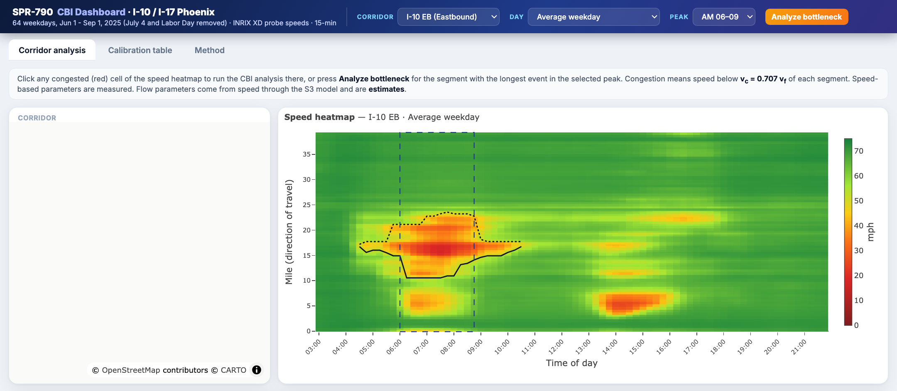
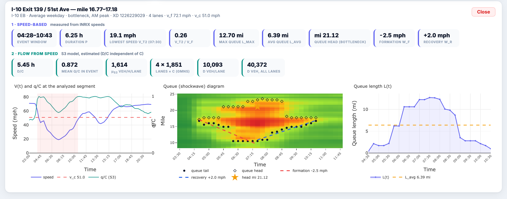
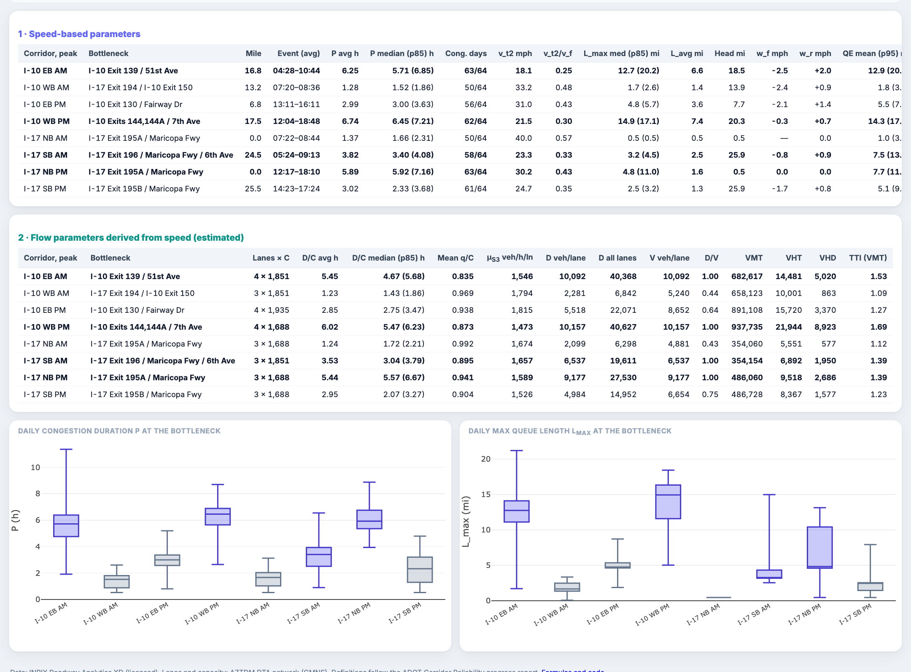

# SPR-790 CBI Analysis — I-10 and I-17 Phoenix

This repository runs a congestion bottleneck identification (CBI) analysis on
I-10 and I-17 in Phoenix over **one common window: 64 weekdays, June 1 –
September 1, 2025**, using INRIX probe speeds. It produces two things:

- an interactive **CBI dashboard**
- a **per-corridor calibration table** (one row per corridor, direction and
  weekday peak)

### ▶ [Open the dashboard](https://jacky850.github.io/spr790-cbi-calibration/)



## What the dashboard does

| | |
|---|---|
| **Pick a corridor, profile and peak** | Corridors: I-10 EB/WB and I-17 NB/SB. Profiles over the 64 weekdays: *average*, *median*, *bad day* (15th-percentile speed) or *worst days* (5th-percentile speed). Peaks: AM (06–09) or PM (14–18). |
| **See the congestion pattern** | The time–space speed heatmap shows each queue; the map shows where it sits on the corridor. |
| **Click a red cell** | The CBI analysis runs at that spot. **Analyze bottleneck** jumps to the segment with the longest event in the peak. |
| **Read the result** | Speed-based results: event window, duration P, lowest speed, max/avg queue length, queue head (bottleneck) and formation/recovery speeds. Flow results from speed: D/C, mean q/C, discharge rate, and the volume D. |
| **Check it visually** | Three charts: speed V(t) with q/C, a queue (shockwave) diagram with fitted formation/recovery lines, and queue length L(t). |
| **Compare corridors** | The *Calibration table* tab lists all eight corridor-peaks, with the daily spread of P and queue length. |



## Key results

These are the parameters reported in the ADOT Corridor Reliability progress
report (slide 17), plus the queue measures from the CBI dashboard. All values
are taken at the bottleneck on the **average weekday**. The four
peak-direction rows match slide 17 of the progress report.

| Corridor, peak | Bottleneck | Event window | Duration P (h) | D/C (h) | Max queue L<sub>max</sub> (mi) | Queue extent QE, mean (p95), mi | Lowest speed (mph) | Congested days |
|---|---|---|---|---|---|---|---|---|
| **I-10 EB AM** | 51st Ave (mi 16.8) | 04:28–10:44 | **6.3** | 5.5 | 12.7 | 12.9 (20.7) | 18 | 63 / 64 |
| **I-10 WB PM** | 7th Ave (mi 17.5) | 12:04–18:48 | **6.7** | 6.0 | 14.9 | 14.3 (17.2) | 22 | 62 / 64 |
| **I-17 SB AM** | 6th Ave (mi 24.5) ¹ | 05:24–09:13 | **3.8** | 3.5 | 3.2 | 7.5 (13.8) | 23 | 58 / 64 |
| **I-17 NB PM** | I-10 split, Exit 195A (mi 0.0) ¹ | 12:17–18:10 | **5.9** | 5.4 | 4.8 | 7.7 (11.4) | 30 | 63 / 64 |
| I-10 WB AM | I-17 / I-10 Exit 150 (mi 13.2) | 07:20–08:36 | 1.3 | 1.2 | 1.7 | 1.8 (3.2) | 33 | 50 / 64 |
| I-10 EB PM | Fairway Dr (mi 6.8) | 13:11–16:11 | 3.0 | 2.9 | 4.8 | 5.5 (7.7) | 31 | 56 / 64 |
| I-17 NB AM | I-10 split, Exit 195A (mi 0.0) ¹ | 07:22–08:44 | 1.4 | 1.2 | 0.5 | 1.0 (3.2) | 40 | 50 / 64 |
| I-17 SB PM | I-10 split, Exit 195B (mi 25.5) ¹ | 14:23–17:24 | 3.0 | 3.0 | 2.6 | 5.1 (9.7) | 25 | 61 / 64 |

Notes on the columns:

- **Max queue** and **lowest speed** are medians over congested weekdays.
- **Congested days** counts weekdays with an event at the bottleneck.
- Mile = distance from the corridor start in the direction of travel.

¹ The bottleneck sits at the I-10/I-17 split, which is the limit of the study
area. The queue can extend past it, so the queue measures are lower bounds.

The dashboard's *Calibration table* tab shows the full table, split into
speed-based and flow parameters, together with the daily spread of P and
queue length:



**Full table.** [`results/calibration_table.csv`](results/calibration_table.csv)
also contains:

- the daily spread of P and D/C (median, p85, p95)
- average queue length, queue head, and formation/recovery speeds
- lanes, v<sub>f</sub>, v<sub>c</sub> and capacity C
- D, V and D/V
- corridor VMT, VHT and VHD


## Parameters in brief

Detailed definitions and formulas are in
**[docs/definitions.md](docs/definitions.md)**.

**1 · Speed-based (measured)**

| Parameter | Meaning |
|---|---|
| v<sub>c</sub> | Congestion threshold = 0.707 × free-flow speed v<sub>f</sub> of each segment. v<sub>f</sub> is the 85th-percentile weekday night speed. |
| Event window, P | Time the bottleneck stays below v<sub>c</sub> (15-min speeds). The event may run past the peak period. |
| Bottleneck | Segment with the longest event on the average weekday |
| Lowest speed v<sub>t2</sub> | Minimum speed during the event |
| L<sub>max</sub>, L<sub>avg</sub>, queue head | Length of the congested stretch through the bottleneck (maximum and time average), and its downstream end |
| Formation / recovery speed | How fast the queue tail moves upstream while the queue grows, and back downstream while it clears (mph) |
| Queue extent QE | Longest congested stretch anywhere on the corridor, from 2 h before to 2 h after the peak |

**2 · Flow derived from speed (estimated)**

| Parameter | Meaning |
|---|---|
| q/C | Flow relative to capacity from speed through the S3 model. Capacity cancels, so q/C needs no C. |
| D/C (h) | Sum of q/C over the event: hours of capacity flow during congestion. Independent of C. |
| μ<sub>S3</sub> | Mean flow during the event (veh/h/lane): speed-implied discharge rate |
| D, V | Vehicles per lane during the event and over the peak. They use C from the AZTDM network (1,688–1,935 veh/h/lane). |
| VMT, VHT, VHD | Corridor totals for the peak |

> D/C tracks P closely, because congested speeds map to q/C near 1. Volumes D,
> V and VMT are upper estimates: speed-based flows ran 1.4–1.6× the AZTDM ATR
> counts in the progress report. Both improve once the S3 relation is
> calibrated with counts.

## Data

| Corridor | Limits | Length per direction | INRIX XD segments |
|---|---|---|---|
| I-10 Phoenix | Exit 122 (Perryville Rd) – Exit 162 (Wild Horse Pass Blvd) | 39.3 mi | 89 EB, 89 WB |
| I-17 Phoenix | Exit 194 (I-10 split) – Exit 223 (Loop 303) | 26.3 mi NB, 25.9 mi SB | 56 NB, 50 SB |

- **Speeds:** INRIX Roadway Analytics XD, 5-minute, ≥ 99.7% real-time probe
  data. The INRIX data is licensed. This repository and the public dashboard
  contain only aggregates: speed profiles over the 64 weekdays and summary
  statistics. Single-day speeds and per-day records are not published.
- **Lanes and capacity:** AZTDM DTA network (GMNS).
- **Segment order:** [adot-corridor-reliability](https://github.com/jacky850/adot-corridor-reliability).

## Repository

```
├── docs/
│   ├── index.html            dashboard (GitHub Pages)
│   ├── definitions.md        detailed definitions and formulas
│   └── img/                  screenshots
├── results/
│   └── calibration_table.csv one row per corridor × direction × peak
├── scripts/
│   ├── 01_convert_inrix_xd.py    INRIX XD download -> mph readings
│   └── 02_calibration_table.py   calibration table
└── dashboard/
    ├── cbi_core.js           CBI analysis used by the dashboard
    ├── test_core.js          checks cbi_core.js against the Python results
    ├── export_data.py, template.html, build_dashboard.py
```

The dashboard's JavaScript analysis reproduces the Python results on 462
bottleneck-days. The median difference is 0.001 h in P and 0.003 mi in
L<sub>max</sub>, and 99% of days agree within 0.01. The remaining gap comes
from speeds stored to 0.1 mph.

## Reproduce

```bash
pip install -r requirements.txt
# needs the licensed INRIX download and adot-corridor-reliability outputs in ../ADOT Corridor Reliability
python scripts/01_convert_inrix_xd.py
python scripts/02_calibration_table.py
python dashboard/export_data.py && python dashboard/build_dashboard.py   # public build
CBI_FULL=1 python dashboard/export_data.py && node dashboard/test_core.js   # local check only, do not publish
```
